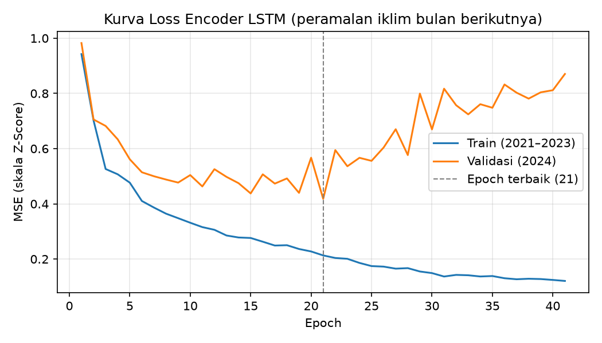
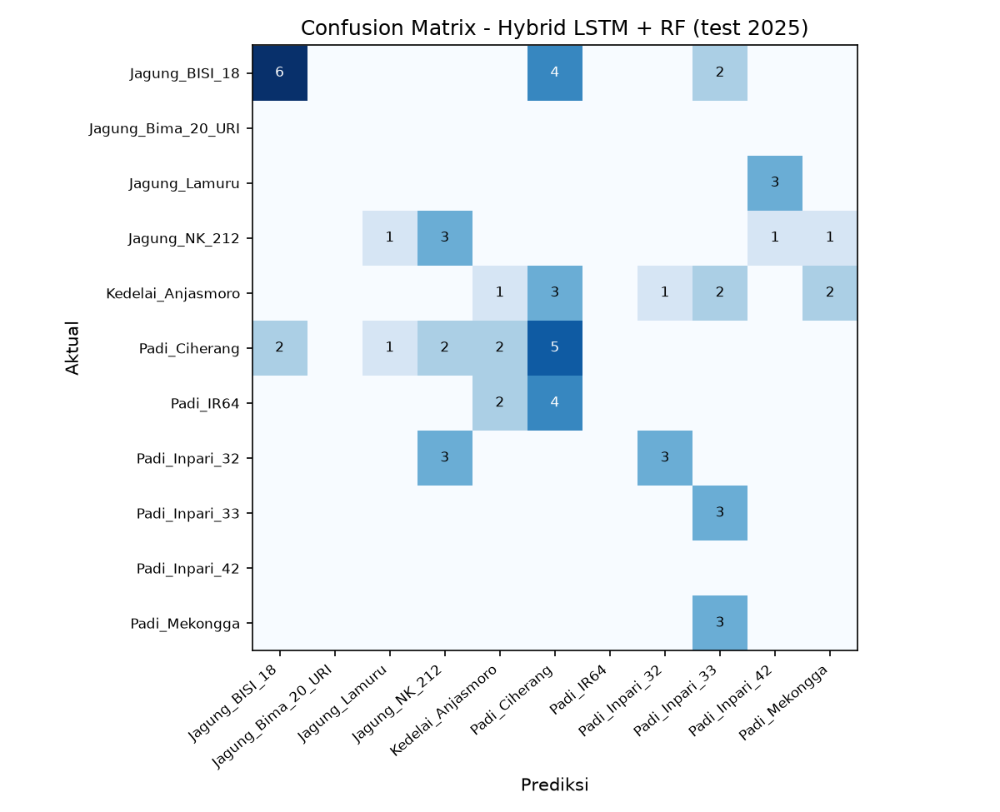
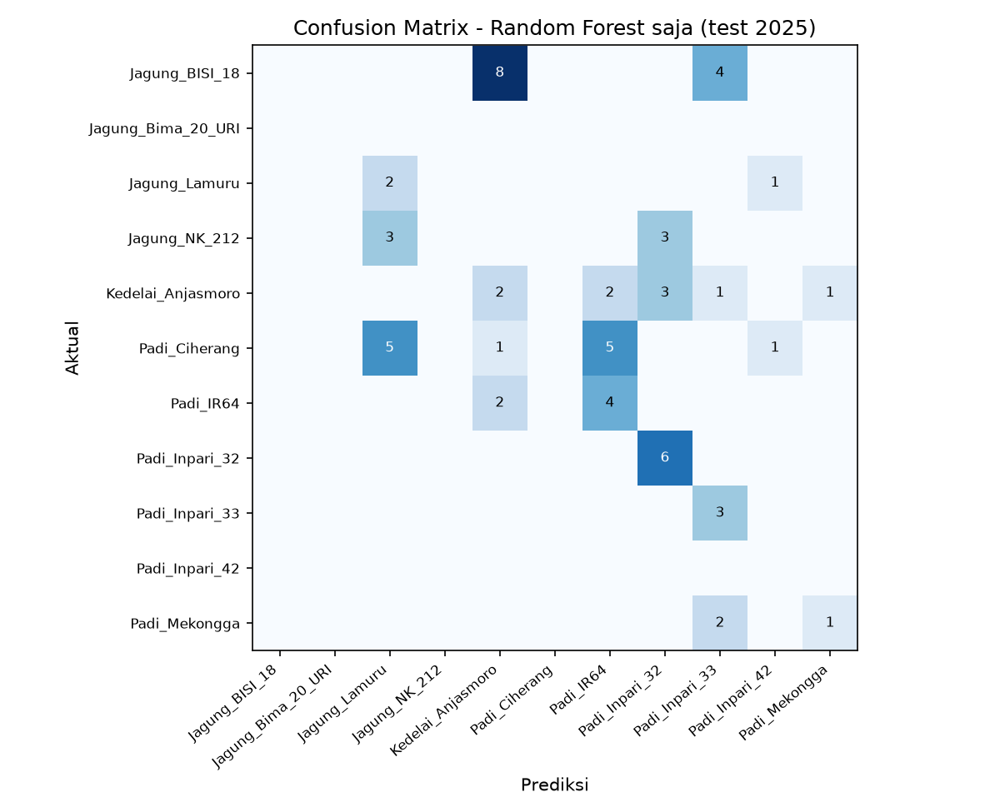
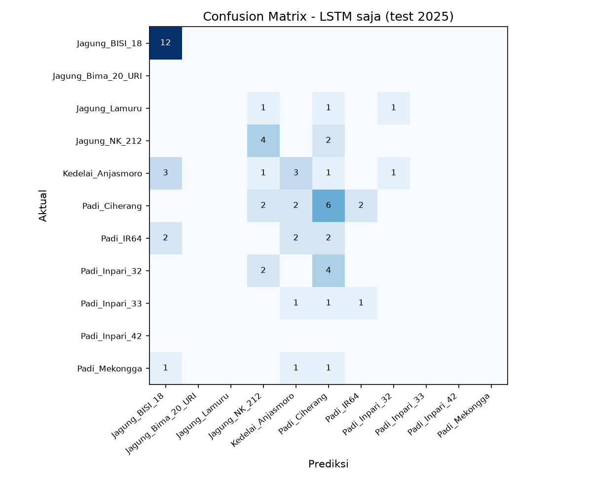
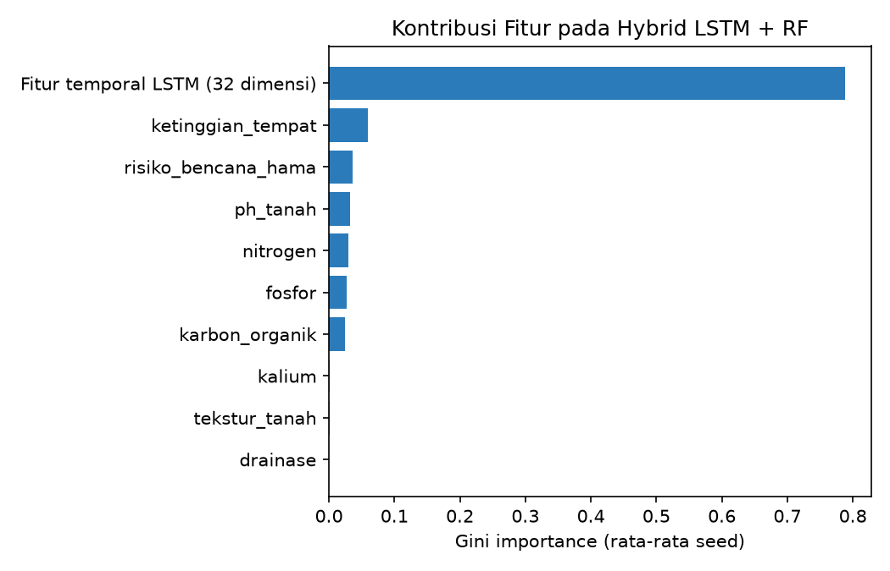

# Hasil Eksperimen Model Hybrid LSTM–Random Forest (Eksperimen Fitur Harian)

> **PERINGATAN — HASIL PROTOTIPE.** Label varietas dibuat dengan aturan dummy
> (`beri_label_varietas_prototipe`) dan 5 dari 9 fitur tanah (N, P, K, drainase, risiko hama) masih dummy.
> Angka di bawah membuktikan **pipeline** berjalan sesuai rancangan proposal, tetapi **belum dapat diklaim
> sebagai temuan penelitian**. Jalankan ulang `python train_hybrid_harian.py` setelah data riil tersedia.

- Run: `20261124_223249` · commit `a2a7f32` · 2026-11-24 22:32:49
- Lokasi aktif: L001, L002, L003, L004, L005 · Seed: 42, 43, 44, 45, 46
- Script: `train_hybrid_proposal.py`

## 4.1 Dataset dan Pembagian Data

Satu sampel = satu lokasi pada satu bulan target. Input LSTM adalah sekuens iklim **12 bulan**
sebelum bulan target, sehingga tidak ada informasi bulan target yang digunakan. Data dibagi kronologis
(Bagian 3.7 dan 3.11 proposal):

| Bagian | Tahun bulan target | Jumlah sampel | Porsi |
|---|---|---|---|
| Training | 2021–2023 | 180 | 60% |
| Validation | 2024 | 60 | 20% |
| Testing | 2025 | 60 | 20% |

Porsi pelatihan (training + validation) = 80%, pengujian = 20%.
Jumlah kelas varietas: 11.

**Tabel 4.1 Distribusi kelas varietas**

| varietas | train | validasi | test |
|---|---|---|---|
| Jagung_BISI_18 | 21 | 3 | 12 |
| Jagung_Bima_20_URI | 2 | 0 | 0 |
| Jagung_Lamuru | 4 | 3 | 3 |
| Jagung_NK_212 | 18 | 2 | 6 |
| Kedelai_Anjasmoro | 16 | 15 | 9 |
| Padi_Ciherang | 45 | 8 | 12 |
| Padi_IR64 | 18 | 10 | 6 |
| Padi_Inpari_32 | 17 | 4 | 6 |
| Padi_Inpari_33 | 14 | 2 | 3 |
| Padi_Inpari_42 | 8 | 4 | 0 |
| Padi_Mekongga | 17 | 9 | 3 |

## 4.2 Hasil Preprocessing

Missing value diinterpolasi linier per lokasi. Outlier ditangani dengan metode IQR (pagar Q1 − 1,5·IQR dan
Q3 + 1,5·IQR) lalu dinormalisasi Z-Score; seluruh statistik dihitung **hanya dari data periode training**.
Jumlah nilai yang dibatasi (capping): **14**. Fitur turunan: indeks musim (sin/cos bulan) + 5 fitur ringkasan data harian per bulan (hari_hujan, hari_hujan_lebat, hujan_harian_maks, kering_beruntun_maks, hari_panas).

**Tabel 4.2 Parameter preprocessing iklim bulanan**

| variabel | batas_bawah_IQR | batas_atas_IQR | mean_Z | std_Z |
|---|---|---|---|---|
| curah_hujan | -89.015 | 470.385 | 198.029 | 101.4415 |
| suhu_rata_rata | 20.1389 | 31.1569 | 25.8083 | 1.4483 |
| suhu_maksimal | 25.0598 | 32.0675 | 28.4792 | 1.1218 |
| suhu_minimum | 16.7503 | 30.365 | 23.7306 | 1.7408 |
| kelembaban_rata_rata | 73.0924 | 94.6736 | 84.3106 | 3.4322 |
| lama_penyinaran | 11.2877 | 22.1365 | 16.78 | 2.0619 |

## 4.3 Pelatihan Encoder LSTM

Arsitektur sesuai Bagian 3.10: LSTM 128 unit → LSTM 64 unit (dropout 0.2) → Dense
32 unit (ReLU) sebagai vektor fitur temporal. Encoder dilatih meramal iklim bulan
berikutnya (MSE) sehingga tidak menggunakan label varietas; early stopping (patience
20) berdasarkan loss validasi 2024.

**Tabel 4.3 Hasil pelatihan LSTM dan pembanding ramalan naif (MAE pada test 2025, skala Z-Score)**

| seed | epoch terbaik | MSE validasi | MAE test LSTM | MAE persistence | MAE klimatologi |
|---|---|---|---|---|---|
| 42 | 21 | 0.4181 | 0.5034 | 0.5951 | 0.8116 |
| 43 | 21 | 0.4826 | 0.4624 | 0.5951 | 0.8116 |
| 44 | 11 | 0.4763 | 0.4508 | 0.5951 | 0.8116 |
| 45 | 10 | 0.4951 | 0.4862 | 0.5951 | 0.8116 |
| 46 | 21 | 0.4126 | 0.4772 | 0.5951 | 0.8116 |

Persistence = iklim bulan sebelumnya; klimatologi = rata-rata bulan yang sama pada periode training.

## 4.4 Hyperparameter Tuning Random Forest

RandomizedSearchCV (20 kombinasi, skor F1-weighted) dengan cross-validation expanding-window per
tahun (validasi 2023, 2024), kemudian model di-*refit* pada training + validation.

**Tabel 4.4 Hyperparameter terbaik Hybrid LSTM + RF per seed**

| seed | best_params |
|---|---|
| 42 | {"n_estimators": 200, "min_samples_split": 5, "min_samples_leaf": 1, "max_features": 0.5, "max_depth": 30, "class_weight": "balanced_subsample"} |
| 43 | {"n_estimators": 300, "min_samples_split": 5, "min_samples_leaf": 4, "max_features": "sqrt", "max_depth": 10, "class_weight": "balanced"} |
| 44 | {"n_estimators": 300, "min_samples_split": 10, "min_samples_leaf": 4, "max_features": 0.5, "max_depth": 15, "class_weight": "balanced"} |
| 45 | {"n_estimators": 200, "min_samples_split": 5, "min_samples_leaf": 4, "max_features": "log2", "max_depth": 30, "class_weight": "balanced_subsample"} |
| 46 | {"n_estimators": 100, "min_samples_split": 10, "min_samples_leaf": 1, "max_features": 0.5, "max_depth": null, "class_weight": "balanced_subsample"} |

## 4.5 Perbandingan Kinerja Model (Rumusan Masalah 3)

Evaluasi pada data testing 2025, rata-rata ± simpangan baku dari 5 seed. (w) = weighted average.

**Tabel 4.5 Perbandingan model hybrid dengan single model**

| Model | Accuracy | Precision (w) | Recall (w) | F1-Score (w) | F1-Score (macro) | Top-3 Acc |
|---|---|---|---|---|---|---|
| Hybrid LSTM + RF (usulan) | 0.357 ± 0.048 | 0.431 ± 0.068 | 0.357 ± 0.048 | 0.376 ± 0.053 | 0.264 ± 0.047 | 0.863 ± 0.022 |
| Random Forest saja | 0.290 ± 0.022 | 0.156 ± 0.006 | 0.290 ± 0.022 | 0.194 ± 0.009 | 0.247 ± 0.009 | 0.713 ± 0.025 |
| LSTM saja | 0.387 ± 0.043 | 0.269 ± 0.041 | 0.387 ± 0.043 | 0.311 ± 0.040 | 0.214 ± 0.037 | 0.710 ± 0.036 |

**Tabel 4.6 F1-Score (weighted) per seed**

| seed | Hybrid LSTM + RF | LSTM saja (sekuens iklim) | Random Forest saja (statis + rata-rata iklim) |
|---|---|---|---|
| 42 | 0.339 | 0.34 | 0.2 |
| 43 | 0.366 | 0.254 | 0.186 |
| 44 | 0.446 | 0.304 | 0.204 |
| 45 | 0.316 | 0.357 | 0.183 |
| 46 | 0.413 | 0.302 | 0.199 |

Hybrid lebih tinggi dari Random Forest saja pada **5 dari 5** seed (selisih rata-rata
+0.182) dan lebih tinggi dari LSTM saja pada **3 dari 5** seed
(selisih rata-rata +0.065).

## 4.6 Kinerja per Kelas dan Confusion Matrix

**Tabel 4.7 Precision, Recall, F1 per varietas (seed 42)**

| varietas | support_test | Hybrid_precision | Hybrid_recall | Hybrid_f1 | RF_f1 | LSTM_f1 |
|---|---|---|---|---|---|---|
| Jagung_BISI_18 | 12 | 0.75 | 0.5 | 0.6 | 0.0 | 0.8 |
| Jagung_Bima_20_URI | 0 | 0.0 | 0.0 | 0.0 | 0.0 | 0.0 |
| Jagung_Lamuru | 3 | 0.0 | 0.0 | 0.0 | 0.308 | 0.0 |
| Jagung_NK_212 | 6 | 0.375 | 0.5 | 0.429 | 0.0 | 0.5 |
| Kedelai_Anjasmoro | 9 | 0.2 | 0.111 | 0.143 | 0.182 | 0.333 |
| Padi_Ciherang | 12 | 0.312 | 0.417 | 0.357 | 0.0 | 0.4 |
| Padi_IR64 | 6 | 0.0 | 0.0 | 0.0 | 0.471 | 0.0 |
| Padi_Inpari_32 | 6 | 0.75 | 0.5 | 0.6 | 0.667 | 0.0 |
| Padi_Inpari_33 | 3 | 0.3 | 1.0 | 0.462 | 0.462 | 0.0 |
| Padi_Inpari_42 | 0 | 0.0 | 0.0 | 0.0 | 0.0 | 0.0 |
| Padi_Mekongga | 3 | 0.0 | 0.0 | 0.0 | 0.4 | 0.0 |

## 4.7 Analisis Feature Importance

**Tabel 4.8 Kontribusi kelompok fitur (Gini importance, rata-rata seed)**

| kelompok | jumlah_fitur | importance_total | importance_per_fitur |
|---|---|---|---|
| Fitur temporal LSTM (32 dimensi) | 32 | 0.7882 | 0.0246 |
| ketinggian_tempat | 1 | 0.0597 | 0.0597 |
| risiko_bencana_hama | 1 | 0.0367 | 0.0367 |
| ph_tanah | 1 | 0.0318 | 0.0318 |
| nitrogen | 1 | 0.0298 | 0.0298 |
| fosfor | 1 | 0.0269 | 0.0269 |
| karbon_organik | 1 | 0.0245 | 0.0245 |
| kalium | 1 | 0.0014 | 0.0014 |
| tekstur_tanah | 1 | 0.001 | 0.001 |
| drainase | 1 | 0.0 | 0.0 |

Fitur temporal LSTM berjumlah 32 dari 41 fitur
(78%); bandingkan porsi jumlah ini dengan porsi
importance-nya sebelum menyimpulkan dominasi fitur temporal.

## 4.8 Contoh Rekomendasi Top-3 (Recommendation Engine, Bagian 3.10)

Skor kecocokan = probabilitas kelas dari Random Forest. Varietas label berada di Top-3 pada
**90%** sampel test (seed 42). Daftar lengkap beserta justifikasi:
`rekomendasi_top3_test2025.csv`.

**Tabel 4.9 Contoh rekomendasi (Januari dan Juli 2025)**

| id_lokasi | nama_lokasi | periode | varietas_aktual_label | rekomendasi_1 | rekomendasi_2 | rekomendasi_3 | aktual_di_top_k |
|---|---|---|---|---|---|---|---|
| L001 | Lhoksukon | Jan 2025 | Padi_IR64 | Padi_Ciherang (90.2%) | Kedelai_Anjasmoro (5.3%) | Padi_IR64 (4.0%) | True |
| L001 | Lhoksukon | Jul 2025 | Kedelai_Anjasmoro | Padi_Ciherang (32.9%) | Padi_IR64 (30.3%) | Jagung_BISI_18 (27.1%) | False |
| L002 | Matangkuli | Jan 2025 | Padi_IR64 | Padi_Ciherang (89.7%) | Kedelai_Anjasmoro (5.3%) | Padi_IR64 (4.5%) | True |
| L002 | Matangkuli | Jul 2025 | Kedelai_Anjasmoro | Padi_Ciherang (33.5%) | Padi_IR64 (31.0%) | Jagung_BISI_18 (25.6%) | False |
| L003 | Syamtalira Aron | Jan 2025 | Padi_Mekongga | Padi_Inpari_33 (87.0%) | Kedelai_Anjasmoro (6.9%) | Padi_Mekongga (5.0%) | True |
| L003 | Syamtalira Aron | Jul 2025 | Kedelai_Anjasmoro | Padi_Inpari_33 (48.5%) | Jagung_BISI_18 (24.7%) | Padi_Mekongga (21.0%) | False |
| L004 | Dewantara | Jan 2025 | Padi_Inpari_32 | Jagung_NK_212 (39.4%) | Padi_Inpari_32 (31.5%) | Kedelai_Anjasmoro (16.2%) | True |
| L004 | Dewantara | Jul 2025 | Kedelai_Anjasmoro | Padi_Inpari_32 (57.6%) | Padi_Mekongga (29.6%) | Kedelai_Anjasmoro (11.1%) | True |
| L005 | Kuta Makmur | Jan 2025 | Padi_Ciherang | Jagung_NK_212 (45.2%) | Jagung_Lamuru (27.8%) | Padi_Ciherang (19.9%) | True |
| L005 | Kuta Makmur | Jul 2025 | Jagung_Lamuru | Padi_Inpari_42 (56.1%) | Padi_Ciherang (28.4%) | Jagung_Lamuru (12.5%) | True |

Contoh justifikasi: *pola iklim 12 bulan terakhir (LSTM, 79%); ketinggian_tempat=8.0 mdpl (6%); risiko_bencana_hama=Rendah (4%)*.

## 4.9 Penyesuaian terhadap Proposal dan Keterbatasan

| Aspek | Proposal | Implementasi | Alasan |
|---|---|---|---|
| Panjang sekuens | 60 bulan | 12 bulan | data hanya 72 bulan (2020–2025) |
| Sumber iklim | BMKG | NASA POWER | data BMKG belum tersedia |
| Lama penyinaran | jam/hari | radiasi MJ/m²/hari | variabel NASA POWER ALLSKY_SFC_SW_DWN |
| Objektif pelatihan LSTM | tidak ditentukan | peramalan iklim bulan berikutnya | menghindari kebocoran label ke tahap RF |
| Lokasi | 20 titik | 5 titik | tahap awal |
| Label varietas | data lapangan | aturan dummy | data lapangan belum tersedia |

Keterbatasan: jumlah data test kecil (60 sampel), label dan sebagian fitur tanah masih dummy,
serta validasi pakar dan *user acceptance testing* (Bagian 3.11 Tahap 8) belum dilakukan.
