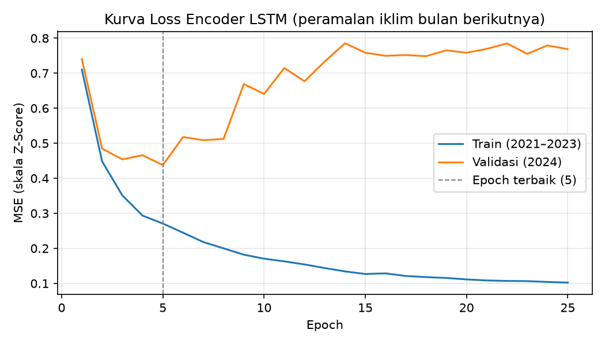
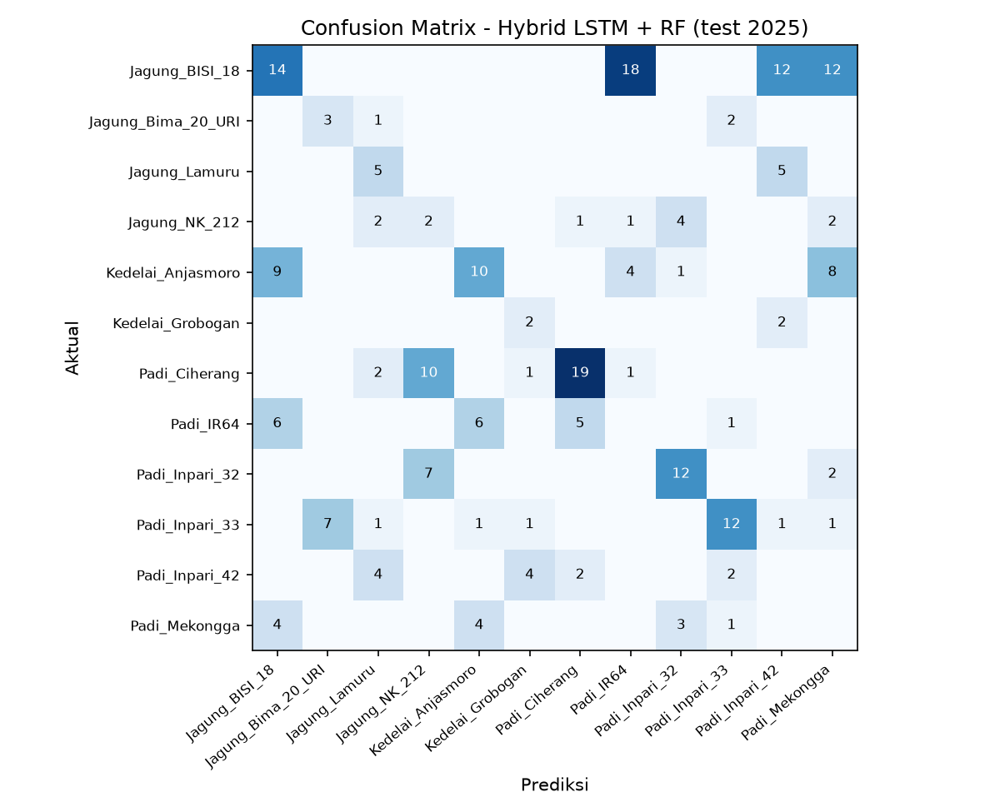
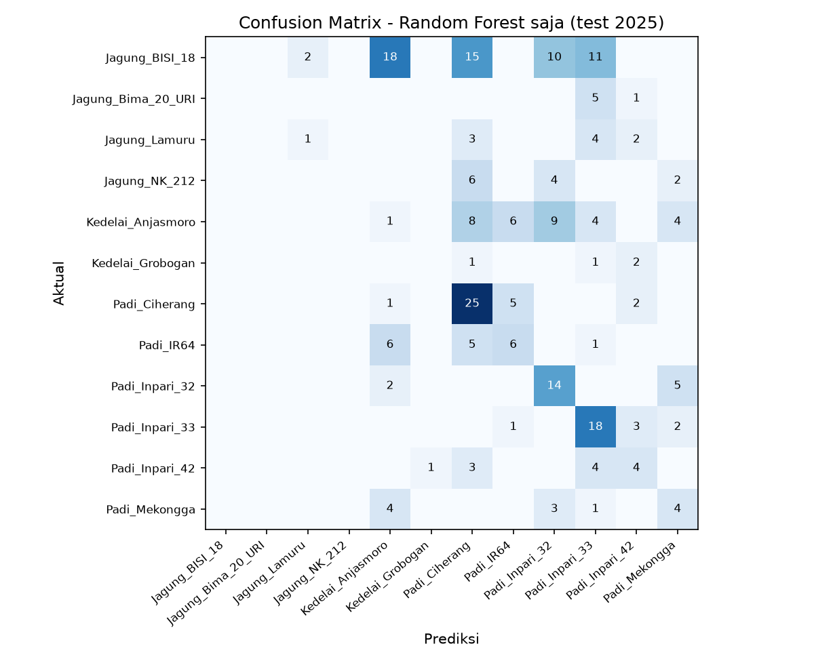
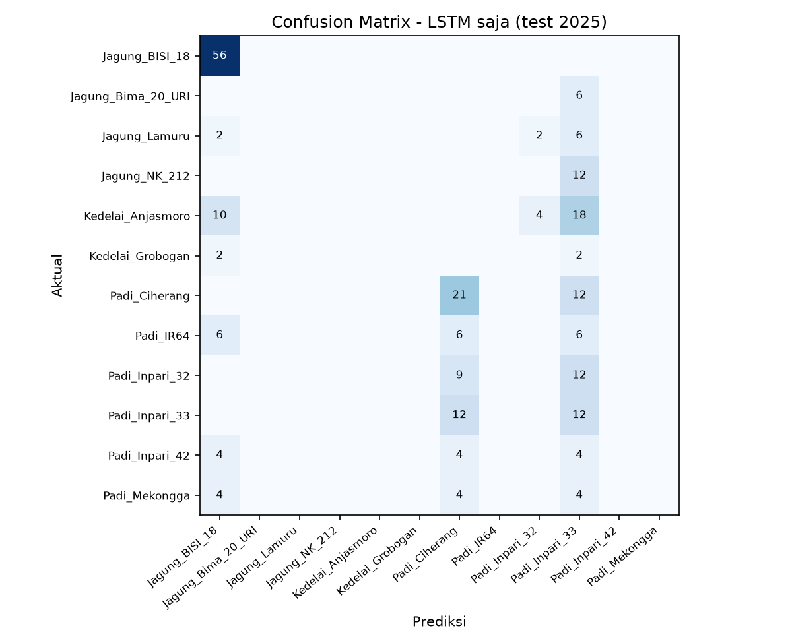
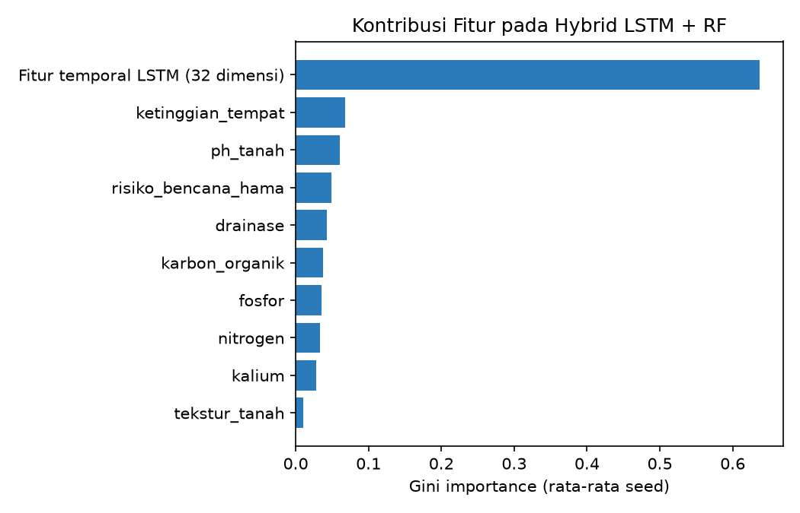

# Hasil Eksperimen Model Hybrid LSTM–Random Forest (Draf Bab IV)

> **PERINGATAN — HASIL PROTOTIPE.** Label varietas dibuat dengan aturan dummy
> (`beri_label_varietas_prototipe`) dan 5 dari 9 fitur tanah (N, P, K, drainase, risiko hama) masih dummy.
> Angka di bawah membuktikan **pipeline** berjalan sesuai rancangan proposal, tetapi **belum dapat diklaim
> sebagai temuan penelitian**. Jalankan ulang `python train_hybrid_proposal.py` setelah data riil tersedia.

- Run: `20261125_004642` · commit `7183299` · 2026-11-25 00:46:42
- Lokasi aktif: L001, L002, L003, L004, L005, L006, L007, L008, L009, L010, L011, L012, L013, L014, L015, L016, L017, L018, L019, L020 · Seed: 42, 43, 44, 45, 46
- Script: `train_hybrid_proposal.py`

## 4.1 Dataset dan Pembagian Data

Satu sampel = satu lokasi pada satu bulan target. Input LSTM adalah sekuens iklim **12 bulan**
sebelum bulan target, sehingga tidak ada informasi bulan target yang digunakan. Data dibagi kronologis
(Bagian 3.7 dan 3.11 proposal):

| Bagian | Tahun bulan target | Jumlah sampel | Porsi |
|---|---|---|---|
| Training | 2021–2023 | 720 | 60% |
| Validation | 2024 | 240 | 20% |
| Testing | 2025 | 240 | 20% |

Porsi pelatihan (training + validation) = 80%, pengujian = 20%.
Jumlah kelas varietas: 12.

**Tabel 4.1 Distribusi kelas varietas**

| varietas | train | validasi | test |
|---|---|---|---|
| Jagung_BISI_18 | 98 | 14 | 56 |
| Jagung_Bima_20_URI | 22 | 2 | 6 |
| Jagung_Lamuru | 16 | 14 | 10 |
| Jagung_NK_212 | 48 | 4 | 12 |
| Kedelai_Anjasmoro | 56 | 52 | 32 |
| Kedelai_Grobogan | 8 | 8 | 4 |
| Padi_Ciherang | 132 | 22 | 33 |
| Padi_IR64 | 62 | 34 | 18 |
| Padi_Inpari_32 | 76 | 14 | 21 |
| Padi_Inpari_33 | 90 | 16 | 24 |
| Padi_Inpari_42 | 52 | 28 | 12 |
| Padi_Mekongga | 60 | 32 | 12 |

## 4.2 Hasil Preprocessing

Missing value diinterpolasi linier per lokasi. Outlier ditangani dengan metode IQR (pagar Q1 − 1,5·IQR dan
Q3 + 1,5·IQR) lalu dinormalisasi Z-Score; seluruh statistik dihitung **hanya dari data periode training**.
Jumlah nilai yang dibatasi (capping): **61**. Fitur turunan indeks musim: sin/cos bulan.

**Tabel 4.2 Parameter preprocessing iklim bulanan**

| variabel | batas_bawah_IQR | batas_atas_IQR | mean_Z | std_Z |
|---|---|---|---|---|
| curah_hujan | -64.93 | 431.39 | 196.086 | 100.3034 |
| suhu_rata_rata | 21.3231 | 30.7 | 26.0776 | 1.375 |
| suhu_maksimal | 25.2635 | 32.0377 | 28.6433 | 1.0882 |
| suhu_minimum | 17.9677 | 29.6924 | 24.0696 | 1.6385 |
| kelembaban_rata_rata | 72.9685 | 93.8937 | 83.8097 | 3.3371 |
| lama_penyinaran | 11.3305 | 22.1627 | 16.846 | 2.0365 |

## 4.3 Pelatihan Encoder LSTM

Arsitektur sesuai Bagian 3.10: LSTM 128 unit → LSTM 64 unit (dropout 0.2) → Dense
32 unit (ReLU) sebagai vektor fitur temporal. Encoder dilatih meramal iklim bulan
berikutnya (MSE) sehingga tidak menggunakan label varietas; early stopping (patience
20) berdasarkan loss validasi 2024.

**Tabel 4.3 Hasil pelatihan LSTM dan pembanding ramalan naif (MAE pada test 2025, skala Z-Score)**

| seed | epoch terbaik | MSE validasi | MAE test LSTM | MAE persistence | MAE klimatologi |
|---|---|---|---|---|---|
| 42 | 5 | 0.4378 | 0.461 | 0.5795 | 0.7831 |
| 43 | 4 | 0.4938 | 0.4751 | 0.5795 | 0.7831 |
| 44 | 19 | 0.4485 | 0.4341 | 0.5795 | 0.7831 |
| 45 | 3 | 0.483 | 0.4716 | 0.5795 | 0.7831 |
| 46 | 4 | 0.4301 | 0.4558 | 0.5795 | 0.7831 |

Persistence = iklim bulan sebelumnya; klimatologi = rata-rata bulan yang sama pada periode training.

## 4.4 Hyperparameter Tuning Random Forest

RandomizedSearchCV (20 kombinasi, skor F1-weighted) dengan cross-validation expanding-window per
tahun (validasi 2023, 2024), kemudian model di-*refit* pada training + validation.

**Tabel 4.4 Hyperparameter terbaik Hybrid LSTM + RF per seed**

| seed | best_params |
|---|---|
| 42 | {"n_estimators": 100, "min_samples_split": 2, "min_samples_leaf": 4, "max_features": "log2", "max_depth": 30, "class_weight": "balanced_subsample"} |
| 43 | {"n_estimators": 300, "min_samples_split": 5, "min_samples_leaf": 4, "max_features": "sqrt", "max_depth": 10, "class_weight": "balanced"} |
| 44 | {"n_estimators": 300, "min_samples_split": 5, "min_samples_leaf": 1, "max_features": "sqrt", "max_depth": 20, "class_weight": "balanced_subsample"} |
| 45 | {"n_estimators": 500, "min_samples_split": 10, "min_samples_leaf": 1, "max_features": "log2", "max_depth": 20, "class_weight": "balanced"} |
| 46 | {"n_estimators": 300, "min_samples_split": 10, "min_samples_leaf": 4, "max_features": "log2", "max_depth": 30, "class_weight": "balanced"} |

## 4.5 Perbandingan Kinerja Model (Rumusan Masalah 3)

Evaluasi pada data testing 2025, rata-rata ± simpangan baku dari 5 seed. (w) = weighted average.

**Tabel 4.5 Perbandingan model hybrid dengan single model**

| Model | Accuracy | Precision (w) | Recall (w) | F1-Score (w) | F1-Score (macro) | Top-3 Acc |
|---|---|---|---|---|---|---|
| Hybrid LSTM + RF (usulan) | 0.367 ± 0.033 | 0.461 ± 0.044 | 0.367 ± 0.033 | 0.388 ± 0.022 | 0.332 ± 0.017 | 0.788 ± 0.053 |
| Random Forest saja | 0.313 ± 0.016 | 0.215 ± 0.027 | 0.313 ± 0.016 | 0.243 ± 0.016 | 0.241 ± 0.032 | 0.676 ± 0.014 |
| LSTM saja | 0.345 ± 0.034 | 0.204 ± 0.024 | 0.345 ± 0.034 | 0.246 ± 0.028 | 0.119 ± 0.025 | 0.545 ± 0.034 |

**Tabel 4.6 F1-Score (weighted) per seed**

| seed | Hybrid LSTM + RF | LSTM saja (sekuens iklim) | Random Forest saja (statis + rata-rata iklim) |
|---|---|---|---|
| 42 | 0.357 | 0.272 | 0.224 |
| 43 | 0.401 | 0.2 | 0.249 |
| 44 | 0.402 | 0.244 | 0.264 |
| 45 | 0.409 | 0.259 | 0.23 |
| 46 | 0.372 | 0.257 | 0.247 |

Hybrid lebih tinggi dari Random Forest saja pada **5 dari 5** seed (selisih rata-rata
+0.146) dan lebih tinggi dari LSTM saja pada **5 dari 5** seed
(selisih rata-rata +0.142).

## 4.6 Kinerja per Kelas dan Confusion Matrix

**Tabel 4.7 Precision, Recall, F1 per varietas (seed 42)**

| varietas | support_test | Hybrid_precision | Hybrid_recall | Hybrid_f1 | RF_f1 | LSTM_f1 |
|---|---|---|---|---|---|---|
| Jagung_BISI_18 | 56 | 0.424 | 0.25 | 0.315 | 0.0 | 0.8 |
| Jagung_Bima_20_URI | 6 | 0.3 | 0.5 | 0.375 | 0.0 | 0.0 |
| Jagung_Lamuru | 10 | 0.333 | 0.5 | 0.4 | 0.154 | 0.0 |
| Jagung_NK_212 | 12 | 0.105 | 0.167 | 0.129 | 0.0 | 0.0 |
| Kedelai_Anjasmoro | 32 | 0.476 | 0.312 | 0.377 | 0.031 | 0.0 |
| Kedelai_Grobogan | 4 | 0.25 | 0.5 | 0.333 | 0.0 | 0.0 |
| Padi_Ciherang | 33 | 0.704 | 0.576 | 0.633 | 0.505 | 0.472 |
| Padi_IR64 | 18 | 0.0 | 0.0 | 0.0 | 0.333 | 0.0 |
| Padi_Inpari_32 | 21 | 0.6 | 0.571 | 0.585 | 0.459 | 0.0 |
| Padi_Inpari_33 | 24 | 0.667 | 0.5 | 0.571 | 0.493 | 0.203 |
| Padi_Inpari_42 | 12 | 0.0 | 0.0 | 0.0 | 0.308 | 0.0 |
| Padi_Mekongga | 12 | 0.0 | 0.0 | 0.0 | 0.276 | 0.0 |

## 4.7 Analisis Feature Importance

**Tabel 4.8 Kontribusi kelompok fitur (Gini importance, rata-rata seed)**

| kelompok | jumlah_fitur | importance_total | importance_per_fitur |
|---|---|---|---|
| Fitur temporal LSTM (32 dimensi) | 32 | 0.637 | 0.0199 |
| ketinggian_tempat | 1 | 0.0677 | 0.0677 |
| ph_tanah | 1 | 0.0602 | 0.0602 |
| risiko_bencana_hama | 1 | 0.0487 | 0.0487 |
| drainase | 1 | 0.0424 | 0.0424 |
| karbon_organik | 1 | 0.0374 | 0.0374 |
| fosfor | 1 | 0.0353 | 0.0353 |
| nitrogen | 1 | 0.0332 | 0.0332 |
| kalium | 1 | 0.0279 | 0.0279 |
| tekstur_tanah | 1 | 0.0102 | 0.0102 |

Fitur temporal LSTM berjumlah 32 dari 41 fitur
(78%); bandingkan porsi jumlah ini dengan porsi
importance-nya sebelum menyimpulkan dominasi fitur temporal.

## 4.8 Contoh Rekomendasi Top-3 (Recommendation Engine, Bagian 3.10)

Skor kecocokan = probabilitas kelas dari Random Forest. Varietas label berada di Top-3 pada
**70%** sampel test (seed 42). Daftar lengkap beserta justifikasi:
`rekomendasi_top3_test2025.csv`.

**Tabel 4.9 Contoh rekomendasi (Januari dan Juli 2025)**

| id_lokasi | nama_lokasi | periode | varietas_aktual_label | rekomendasi_1 | rekomendasi_2 | rekomendasi_3 | aktual_di_top_k |
|---|---|---|---|---|---|---|---|
| L001 | Lhoksukon | Jan 2025 | Padi_IR64 | Kedelai_Anjasmoro (38.1%) | Jagung_NK_212 (23.1%) | Padi_Ciherang (16.6%) | False |
| L001 | Lhoksukon | Jul 2025 | Kedelai_Anjasmoro | Jagung_BISI_18 (45.2%) | Padi_IR64 (30.6%) | Padi_Ciherang (10.4%) | False |
| L002 | Matangkuli | Jan 2025 | Padi_IR64 | Kedelai_Anjasmoro (36.7%) | Jagung_NK_212 (26.8%) | Padi_Ciherang (15.7%) | False |
| L002 | Matangkuli | Jul 2025 | Kedelai_Anjasmoro | Jagung_BISI_18 (46.7%) | Padi_IR64 (32.6%) | Padi_Ciherang (9.4%) | False |
| L003 | Syamtalira Aron | Jan 2025 | Padi_Mekongga | Kedelai_Anjasmoro (27.2%) | Padi_Inpari_33 (21.8%) | Jagung_Bima_20_URI (18.8%) | False |
| L003 | Syamtalira Aron | Jul 2025 | Kedelai_Anjasmoro | Jagung_BISI_18 (41.9%) | Padi_Mekongga (30.6%) | Padi_Inpari_33 (10.3%) | False |
| L004 | Dewantara | Jan 2025 | Padi_Inpari_32 | Padi_Inpari_32 (69.4%) | Jagung_NK_212 (11.6%) | Padi_Mekongga (9.5%) | True |
| L004 | Dewantara | Jul 2025 | Kedelai_Anjasmoro | Padi_Mekongga (40.8%) | Padi_Inpari_32 (27.6%) | Kedelai_Anjasmoro (20.0%) | True |
| L005 | Kuta Makmur | Jan 2025 | Padi_Ciherang | Padi_Ciherang (48.6%) | Jagung_Lamuru (22.6%) | Padi_Inpari_42 (15.7%) | True |
| L005 | Kuta Makmur | Jul 2025 | Jagung_Lamuru | Jagung_Lamuru (42.3%) | Padi_Inpari_42 (31.5%) | Padi_Ciherang (13.3%) | True |
| L006 | Muara Batu | Jan 2025 | Padi_Inpari_32 | Padi_Inpari_32 (72.2%) | Jagung_NK_212 (10.9%) | Kedelai_Anjasmoro (10.3%) | True |
| L006 | Muara Batu | Jul 2025 | Kedelai_Anjasmoro | Padi_Inpari_32 (38.1%) | Padi_Mekongga (36.7%) | Kedelai_Anjasmoro (16.4%) | True |
| L007 | Samudera | Jan 2025 | Padi_Mekongga | Kedelai_Anjasmoro (26.5%) | Padi_Inpari_32 (23.7%) | Jagung_NK_212 (22.7%) | False |
| L007 | Samudera | Jul 2025 | Kedelai_Anjasmoro | Jagung_BISI_18 (45.4%) | Padi_Mekongga (31.6%) | Padi_Inpari_32 (10.7%) | False |
| L008 | Tanah Luas | Jan 2025 | Padi_IR64 | Kedelai_Anjasmoro (26.4%) | Jagung_Bima_20_URI (22.6%) | Padi_Inpari_33 (17.6%) | False |
| L008 | Tanah Luas | Jul 2025 | Kedelai_Anjasmoro | Padi_IR64 (36.9%) | Jagung_BISI_18 (23.0%) | Padi_Inpari_33 (14.2%) | False |
| L009 | Nibong | Jan 2025 | Padi_IR64 | Kedelai_Anjasmoro (32.8%) | Jagung_NK_212 (27.1%) | Padi_Ciherang (17.2%) | False |
| L009 | Nibong | Jul 2025 | Kedelai_Anjasmoro | Jagung_BISI_18 (43.1%) | Padi_IR64 (34.7%) | Padi_Ciherang (8.9%) | False |
| L010 | Syamtalira Bayu | Jan 2025 | Padi_Inpari_33 | Padi_Inpari_33 (49.9%) | Jagung_Bima_20_URI (20.6%) | Padi_Mekongga (12.9%) | True |
| L010 | Syamtalira Bayu | Jul 2025 | Kedelai_Anjasmoro | Padi_Mekongga (36.7%) | Padi_Inpari_33 (26.8%) | Kedelai_Anjasmoro (23.9%) | True |
| L011 | Meurah Mulia | Jan 2025 | Padi_Ciherang | Padi_Ciherang (54.1%) | Jagung_NK_212 (21.5%) | Padi_IR64 (11.4%) | True |
| L011 | Meurah Mulia | Jul 2025 | Kedelai_Anjasmoro | Padi_IR64 (42.7%) | Kedelai_Anjasmoro (22.4%) | Padi_Ciherang (19.1%) | True |
| L012 | Tanah Pasir | Jan 2025 | Padi_IR64 | Kedelai_Anjasmoro (36.7%) | Jagung_NK_212 (24.8%) | Padi_Ciherang (13.9%) | False |
| L012 | Tanah Pasir | Jul 2025 | Kedelai_Anjasmoro | Jagung_BISI_18 (41.6%) | Padi_IR64 (29.9%) | Padi_Ciherang (9.1%) | False |
| L013 | Lapang | Jan 2025 | Padi_Mekongga | Kedelai_Anjasmoro (29.5%) | Padi_Inpari_32 (23.9%) | Jagung_NK_212 (21.0%) | False |
| L013 | Lapang | Jul 2025 | Kedelai_Anjasmoro | Jagung_BISI_18 (41.6%) | Padi_Mekongga (33.6%) | Padi_Inpari_32 (11.8%) | False |
| L014 | Baktiya | Jan 2025 | Padi_IR64 | Kedelai_Anjasmoro (36.3%) | Jagung_NK_212 (26.4%) | Padi_Ciherang (14.5%) | False |
| L014 | Baktiya | Jul 2025 | Kedelai_Anjasmoro | Jagung_BISI_18 (47.8%) | Padi_IR64 (30.4%) | Padi_Ciherang (9.1%) | False |
| L015 | Baktiya Barat | Jan 2025 | Padi_Mekongga | Kedelai_Anjasmoro (30.3%) | Padi_Inpari_32 (23.4%) | Jagung_NK_212 (18.2%) | False |
| L015 | Baktiya Barat | Jul 2025 | Kedelai_Anjasmoro | Jagung_BISI_18 (44.4%) | Padi_Mekongga (32.1%) | Padi_Inpari_32 (10.2%) | False |
| L016 | Seunuddon | Jan 2025 | Padi_Inpari_42 | Kedelai_Grobogan (44.7%) | Jagung_NK_212 (14.9%) | Padi_Ciherang (11.5%) | False |
| L016 | Seunuddon | Jul 2025 | Kedelai_Grobogan | Padi_Inpari_42 (33.3%) | Jagung_BISI_18 (28.7%) | Kedelai_Grobogan (16.3%) | True |
| L017 | Tanah Jambo Aye | Jan 2025 | Padi_Inpari_42 | Kedelai_Grobogan (40.5%) | Jagung_Bima_20_URI (17.8%) | Padi_Inpari_33 (14.2%) | False |
| L017 | Tanah Jambo Aye | Jul 2025 | Kedelai_Grobogan | Padi_Inpari_42 (32.8%) | Jagung_BISI_18 (32.5%) | Kedelai_Grobogan (13.5%) | True |
| L018 | Langkahan | Jan 2025 | Padi_Inpari_42 | Jagung_Lamuru (37.8%) | Jagung_NK_212 (16.8%) | Kedelai_Anjasmoro (13.0%) | False |
| L018 | Langkahan | Jul 2025 | Jagung_Lamuru | Padi_Inpari_42 (34.1%) | Jagung_BISI_18 (25.1%) | Padi_Ciherang (13.6%) | False |
| L019 | Cot Girek | Jan 2025 | Padi_Inpari_42 | Jagung_Lamuru (34.1%) | Jagung_Bima_20_URI (19.6%) | Padi_Inpari_33 (18.0%) | False |
| L019 | Cot Girek | Jul 2025 | Jagung_Lamuru | Padi_Inpari_42 (35.4%) | Jagung_BISI_18 (27.3%) | Padi_Inpari_33 (16.1%) | False |
| L020 | Sawang | Jan 2025 | Padi_Inpari_33 | Padi_Inpari_33 (51.2%) | Jagung_Lamuru (22.3%) | Jagung_Bima_20_URI (14.3%) | True |
| L020 | Sawang | Jul 2025 | Jagung_Lamuru | Padi_Inpari_42 (37.1%) | Jagung_Lamuru (31.3%) | Padi_Inpari_33 (17.7%) | True |

Contoh justifikasi: *pola iklim 12 bulan terakhir (LSTM, 64%); ketinggian_tempat=8.0 mdpl (7%); ph_tanah=5.3 (6%)*.

## 4.9 Penyesuaian terhadap Proposal dan Keterbatasan

| Aspek | Proposal | Implementasi | Alasan |
|---|---|---|---|
| Panjang sekuens | 60 bulan | 12 bulan | data hanya 72 bulan (2020–2025) |
| Sumber iklim | BMKG | NASA POWER | data BMKG belum tersedia |
| Lama penyinaran | jam/hari | radiasi MJ/m²/hari | variabel NASA POWER ALLSKY_SFC_SW_DWN |
| Objektif pelatihan LSTM | tidak ditentukan | peramalan iklim bulan berikutnya | menghindari kebocoran label ke tahap RF |
| Lokasi | 20 titik | 20 titik | tahap awal |
| Label varietas | data lapangan | aturan dummy | data lapangan belum tersedia |

Keterbatasan: jumlah data test kecil (240 sampel), label dan sebagian fitur tanah masih dummy,
serta validasi pakar dan *user acceptance testing* (Bagian 3.11 Tahap 8) belum dilakukan.
